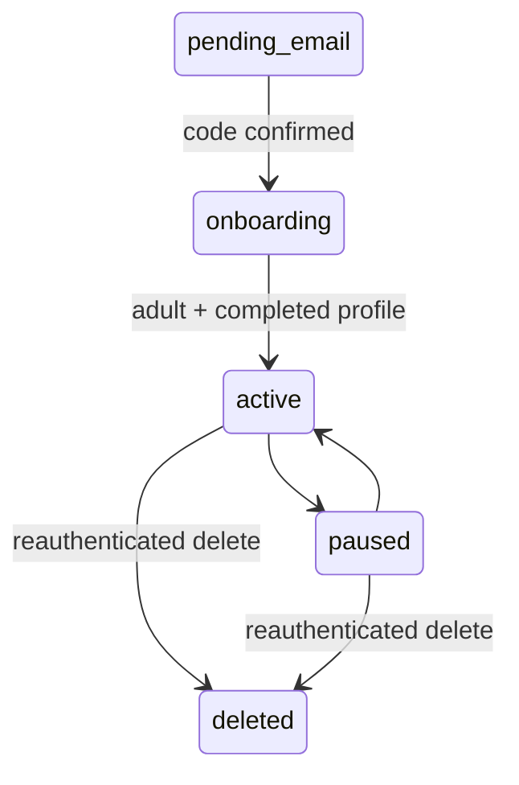
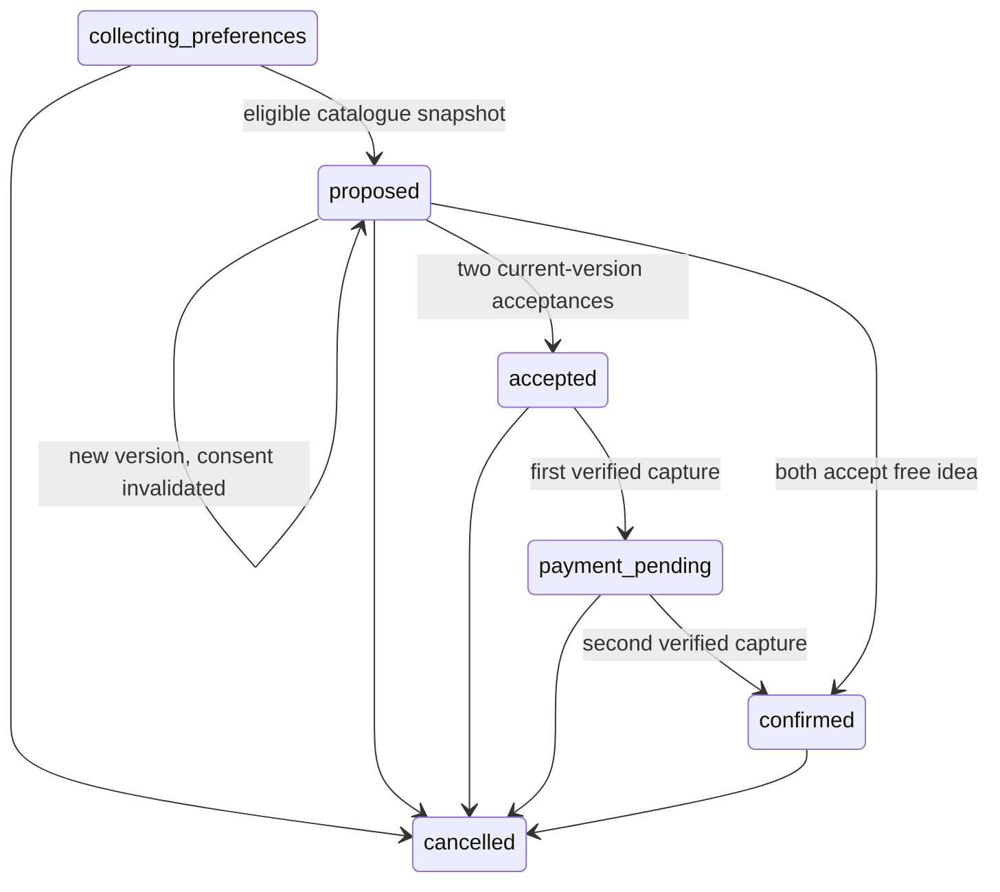

# Architecture, permissions, and state machines

## Data and trust boundaries

The browser holds no authentication bearer token in localStorage. An HttpOnly, SameSite=Lax cookie carries an opaque random session ID. Only its SHA-256 digest is stored in PostgreSQL. Login rotates the session; logout/reset/deletion revoke records. The client obtains a session-bound CSRF value from `/me`; all cookie-authenticated mutations require it plus exact `APP_ORIGIN`. Signup/login also require that exact origin. HTTPS origins cause Secure cookies.

This is a single persistent API instance with a PostgreSQL pool and an in-process worker. Socket room subscriptions and sends call the same authorization service as REST. Realtime delivery also checks recipient session and match access. Blocking closes a match and removes subscriptions; authorized polling remains a durable fallback. Redis/multi-instance broadcast is not implemented.

`profile_private` contains date of birth and reciprocal preferences. Public profile reads select only `profiles` plus calculated age. Budgets use AES-256-GCM with per-value random IV and authentication tag, under a separate versioned field key. The application server can decrypt them. Encryption is not a claim that the server is blind. Partner DTOs expose only their own preference row and whether both saved. Logs contain request ID, route template, method, outcome, and duration; no request bodies, chat, budgets, OTPs, or provider payloads.

## Permission map

| Resource                                                      | Read                                                                      | Mutate                                                                      |
| ------------------------------------------------------------- | ------------------------------------------------------------------------- | --------------------------------------------------------------------------- |
| Public landing, safety, legal drafts, health, partial OpenAPI | Anyone                                                                    | Not applicable                                                              |
| Account and onboarding                                        | Session owner                                                             | Owner + CSRF; email confirmation needed for onboarding                      |
| Discover/profile card                                         | Active eligible member, reciprocal adult/age/gender/same-city constraints | Decision rechecks eligibility under pair lock                               |
| Chat                                                          | Active/paused match participant; no block either direction                | Same rule; max 2,000 chars, deduplicated client UUID, per-sender send limit |
| Date plan                                                     | Authorized active match participant                                       | Participant, current expected version, valid lifecycle state                |
| Private date preference                                       | Exact input returned only to its owner                                    | Only authenticated actor's row; user ID cannot be supplied                  |
| Payment/purchase/receipt                                      | Buyer owner, even after match closure                                     | Owner + current mutually accepted, unexpired plan for create/capture        |
| Refund                                                        | Buyer sees own refund history                                             | Cancellation worker, only against verified capture; full refunds only       |
| Report                                                        | Reporter acknowledgement; moderator sees minimal queue                    | Member creates; moderator/admin updates state with audit reason             |
| Export/delete                                                 | Current account after password check                                      | Owner; exports only own messages, no partner input                          |

No broad budget endpoint or payment-admin role is exposed. Moderator review supports queue metadata and reviewed/dismissed states, not evidence detail, suspension, or step-up workflows yet.

Adult age uses UTC calendar dates; a February 29 birth reaches its anniversary on March 1 in a non-leap year. Birth dates are validated against the calendar before calculating age. This is self-declaration, not identity/age verification.

## Transaction boundaries

Matching takes a canonical pair advisory transaction lock, records the decision, checks reciprocal interest, and inserts a unique low/high match and two deduplicated notifications. The match ID is also the conversation ID; there is no redundant conversation table. Message sends lock the match row to allocate a monotonically increasing sequence and enforce unique `(sender_id,client_id)`.

Plan operations lock match then plan. Proposal creation snapshots the authoritative catalogue and resets consent by advancing version. Budget edits also invalidate the current proposal/consent. Once a checkout attempt exists, revisions are rejected; cancellation and a new plan are required. This conservative restriction prevents checkout races but is narrower than full proposal revision after checkout.

Payment operations are uniquely keyed by `(payment_id,kind)`, producing stable provider request UUIDs. Purchases are unique per plan/version/buyer. Provider network calls occur outside long DB transactions. Captures/refunds are persisted under a payment lock, with unique external IDs and append-only financial events. The worker retries unknown/pending payments and cancellation jobs; it uses the verified webhook inbox as a signal to query provider state rather than trusting event money fields.

## State machines

Suspended records are rejected by session authentication; there is no moderation suspension UI yet. Email confirmation changes only pending_email accounts and cannot reactivate suspension.

Open unfunded/partially funded plans expire after 24 hours. Confirmed plans do not auto-expire. Completion/check-in is not implemented. Cancellation state and financial state are separate: reconciliation_pending → refund_pending/refund_failed/refunded. Cancellation never immediately claims a refund completed.

## Financial invariants

- USD integer cents; one immutable ticket snapshot per buyer/version. Client amounts, sellers, order IDs and currencies are ignored or rejected.
- A plan acceptance never authorizes a payment. Each participant explicitly creates and approves their own order.
- Only a verified COMPLETED capture marks a ticket paid. Pending, onApprove, a query string, or an approval page alone is insufficient.
- Sandbox capture binding checks order, purchase reference/custom ID, expected merchant, one capture, exact USD amount and capture reference.
- Two paid independent purchases are required for confirmation. Free ideas require two acceptances and no checkout.
- One full refund record per payment bounds refunds to the captured amount. Partial refunds are intentionally unavailable.
- Capture that finishes after cancellation is recorded and schedules compensation. Late provider reconciliation cannot overwrite a refunded payment.
- Refunds remain pending until provider completion evidence. Provider timeouts keep durable operations for retries.

## Deployment boundaries

Local/staging only. Production refuses startup until operational review and missing controls are addressed. One API instance/worker is supported. Migration failures roll back their transaction and are not recorded as applied; repair forward with a new migration, restoring backups if necessary. Do not delete migration history or automatically run destructive schema operations. Managed DB TLS/backups, real object storage/email, encryption-key rotation tooling, monitoring and retention policies are outstanding.
